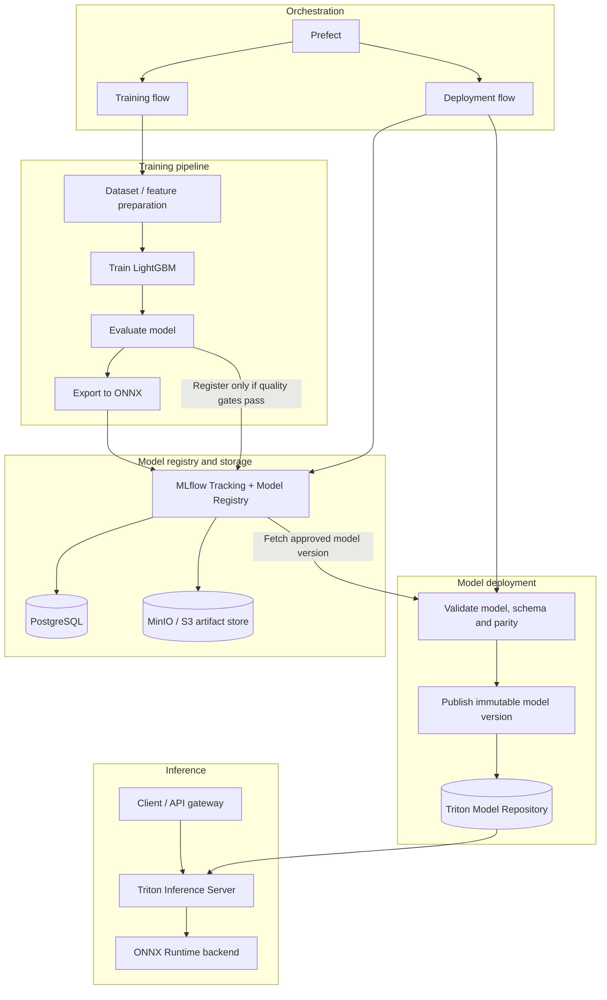
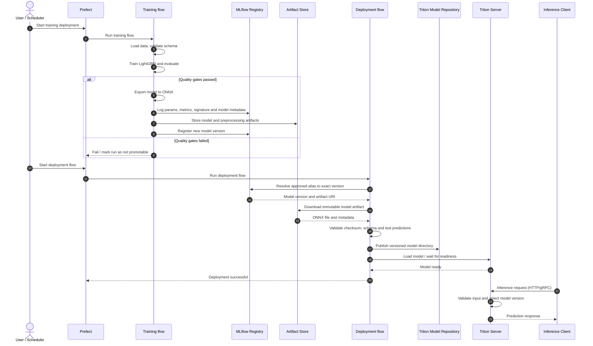

# ML Model Serving Platform

Платформа для экспериментов с полным ML lifecycle: от обучения LightGBM-модели до версионирования, deployment и serving через NVIDIA Triton Inference Server с ONNX Runtime backend.

Основная цель проекта — разделить **training** и **inference** на независимые контуры. Обучение может запускаться по требованию или по расписанию через Prefect, а inference-сервис продолжает обслуживать запросы независимо от состояния training flow.

## Возможности

- **Prefect** — оркестрация training и deployment flows.
- **LightGBM** — обучение табличной ML-модели.
- **MLflow Tracking + Model Registry** — параметры, метрики, артефакты и версии моделей.
- **ONNX** — переносимый формат для serving.
- **NVIDIA Triton Inference Server** — serving ONNX-модели через ONNX Runtime backend.
- **FastAPI (optional)** — альтернативный serving backend для сравнения с Triton.
- **PostgreSQL** — backend-хранилище метаданных MLflow.
- **MinIO / S3** — хранение артефактов MLflow.
- **Docker Compose** — локальная инфраструктура без необходимости поднимать Airflow или Kubernetes.
- **Benchmarking** — сравнение latency, throughput и поведения при конкурентной нагрузке.

## Архитектура



### Диаграмма взаимодействия во время обучения и deployment



## Состав компонентов

| Компонент | Ответственность |
|---|---|
| Prefect | Запуск и наблюдение за training и deployment flows |
| Training flow | Подготовка данных, обучение, оценка, экспорт ONNX |
| MLflow | Tracking, Model Registry, метаданные и версии моделей |
| PostgreSQL | Хранение backend-метаданных MLflow |
| MinIO / S3 | Хранение артефактов моделей и результатов экспериментов |
| Deployment flow | Выбор одобренной версии, проверка и публикация модели |
| Triton Model Repository | Версионированные каталоги моделей для Triton |
| Triton + ONNX Runtime | Загрузка ONNX-модели и выполнение inference |
| FastAPI (optional) | Альтернативный serving endpoint и место для бизнес-валидации |
| Prometheus / Grafana (optional) | Мониторинг latency, throughput, ошибок и ресурсов |

## Поток данных

### 1. Training

1. Prefect запускает training flow.
2. Flow загружает данные и проверяет схему признаков.
3. LightGBM обучается на тренировочном наборе.
4. Модель оценивается на holdout-наборе.
5. Если quality gates пройдены, модель экспортируется в ONNX.
6. MLflow получает параметры, метрики, артефакты и новую версию модели.
7. Новая версия не становится production-моделью автоматически, если политика проекта требует отдельного promotion.

### 2. Deployment

1. Prefect запускает deployment flow отдельно от training flow.
2. Flow разрешает MLflow alias, например `champion`, в конкретный номер версии.
3. Загружает именно эту версию, а не неопределённую «последнюю модель».
4. Проверяет checksum, входную схему, preprocessing и контрольные предсказания.
5. Публикует модель в Triton Model Repository в отдельный каталог версии.
6. Загружает модель в Triton и проверяет readiness.
7. При неудаче deployment flow завершает работу с ошибкой и не должен удалять предыдущую рабочую версию.

### 3. Inference

1. Клиент отправляет запрос в Triton по HTTP или gRPC.
2. Triton выбирает загруженную версию модели.
3. ONNX Runtime backend выполняет inference.
4. Клиент получает предсказание.

**Inference не должен обращаться к Prefect или MLflow на каждый запрос.** Уже загруженная модель должна продолжать работать, даже если оркестратор или registry временно недоступны.

## Triton Model Repository

Пример структуры репозитория модели:

```text
model_repository/
└── lightgbm_classifier/
    ├── config.pbtxt
    └── 1/
        └── model.onnx
```

Номер каталога — версия модели в Triton Model Repository; он не обязан совпадать с номером версии MLflow. Соответствие между ними стоит сохранять в deployment metadata.

Пример `config.pbtxt` для ONNX Runtime backend:

```protobuf
name: "lightgbm_classifier"
backend: "onnxruntime"
max_batch_size: 128

input [
  {
    name: "input"
    data_type: TYPE_FP32
    dims: [ 20 ]
  }
]

output [
  {
    name: "probabilities"
    data_type: TYPE_FP32
    dims: [ 2 ]
  }
]
```

> **Важно:** это иллюстративная конфигурация. Имена входов/выходов, типы данных, размерность признаков и формат вероятностей должны совпадать с фактической ONNX-моделью. Проверь ONNX graph и metadata после экспорта. Для некоторых моделей LightGBM и способов экспорта форма выходного тензора может отличаться.

## Локальный запуск

Локальную инфраструктуру удобно запускать через Docker Compose. Airflow не требуется.

Планируемые сервисы:

- MLflow Tracking Server;
- PostgreSQL;
- MinIO;
- Prefect Server (опционально — для UI, deployments и расписаний);
- Triton Inference Server;
- training/deployment jobs, запускаемые отдельно или как одноразовые контейнеры.

Пример логики запуска:

```bash
# 1. Запустить инфраструктуру
docker compose up -d postgres minio mlflow triton

# 2. Установить Python-зависимости в окружении проекта
pip install -e ".[dev]"

# 3. Запустить обучение
python -m flows.train

# 4. После одобрения модели запустить deployment
python -m flows.deploy

# 5. Проверить состояние Triton
curl http://localhost:8000/v2/health/ready
```

Команды являются целевым интерфейсом проекта: названия сервисов, entry points и extra-зависимости должны соответствовать фактическим файлам реализации.

## Конфигурация

Все адреса сервисов и настройки должны задаваться через переменные окружения, а не быть зашиты в код.

Пример `.env.example`:

```dotenv
MLFLOW_TRACKING_URI=http://localhost:5000
MLFLOW_EXPERIMENT_NAME=lightgbm-serving
MLFLOW_REGISTERED_MODEL_NAME=lightgbm-classifier
MLFLOW_MODEL_ALIAS=champion

PREFECT_API_URL=http://127.0.0.1:4200/api

TRITON_HTTP_URL=localhost:8000
TRITON_GRPC_URL=localhost:8001
TRITON_MODEL_NAME=lightgbm_classifier

ARTIFACT_STORE_ENDPOINT=http://localhost:9000
```

Не коммить реальные credentials. Для MinIO/S3, PostgreSQL и MLflow следует настроить секреты отдельно.

## Качество и безопасность deployment

Перед публикацией модели рекомендуется проверять:

- качество модели относительно текущей production-версии;
- совместимость feature schema и порядка признаков;
- наличие preprocessing и правильность его версии;
- контрольные предсказания на фиксированном наборе примеров;
- checksum и целостность артефактов;
- readiness модели в Triton после загрузки;
- возможность вернуть предыдущую версию без повторного обучения.

Для обновления модели не перезаписывай `model.onnx` на месте. Публикуй неизменяемый каталог новой версии, а загрузкой и переключением управляй явно. Для production-подобного сценария используй согласованный deployment controller и выбранный режим model management Triton.

## Эксперименты и benchmark

План сравнения FastAPI + LightGBM и Triton + ONNX Runtime:

1. Одинаковый датасет и одинаковые входные признаки.
2. Проверка эквивалентности предсказаний с допустимым численным tolerance.
3. Запросы по одной записи и батчами разных размеров.
4. Разное число конкурентных клиентов.
5. Измерение p50/p95/p99 latency, throughput, ошибок и потребления памяти.
6. Повторение тестов после warm-up и с зафиксированными параметрами окружения.

Не предполагай заранее, что Triton быстрее для каждой модели и нагрузки: результат зависит от размера модели, batch size, стоимости preprocessing, сериализации и профиля запросов.

## Предлагаемая структура проекта

```text
.
├── flows/
│   ├── train.py
│   └── deploy.py
├── src/
│   ├── data/
│   ├── training/
│   ├── evaluation/
│   ├── export/
│   ├── registry/
│   └── serving/
├── model_repository/
│   └── lightgbm_classifier/
│       ├── config.pbtxt
│       └── 1/
│           └── model.onnx
├── tests/
│   ├── test_training.py
│   ├── test_onnx_parity.py
│   ├── test_deployment.py
│   └── test_inference.py
├── docker/
├── compose.yaml
├── pyproject.toml
├── .env.example
└── README.md
```

## Roadmap

- [ ] Обучить LightGBM и логировать run в MLflow.
- [ ] Экспортировать модель в ONNX и проверить эквивалентность предсказаний.
- [ ] Зарегистрировать версии модели в MLflow Registry.
- [ ] Реализовать training flow на Prefect.
- [ ] Реализовать отдельный deployment flow.
- [ ] Поднять Triton с ONNX Runtime backend.
- [ ] Автоматизировать публикацию версии в Model Repository и загрузку модели.
- [ ] Добавить rollback и тесты отказоустойчивости.
- [ ] Сравнить FastAPI и Triton на одинаковой нагрузке.
- [ ] Добавить метрики и dashboard.

## Полезная документация

- [Prefect documentation](https://docs.prefect.io/)
- [MLflow Model Registry](https://mlflow.org/docs/latest/ml/model-registry/)
- [MLflow Tracking](https://mlflow.org/docs/latest/ml/tracking/)
- [NVIDIA Triton Inference Server](https://github.com/triton-inference-server/server)
- [Triton ONNX Runtime backend](https://github.com/triton-inference-server/onnxruntime_backend)
- [Triton Model Management](https://docs.nvidia.com/deeplearning/triton-inference-server/user-guide/docs/user_guide/model_management.html)
- [ONNX](https://onnx.ai/)
- [LightGBM](https://lightgbm.readthedocs.io/)
